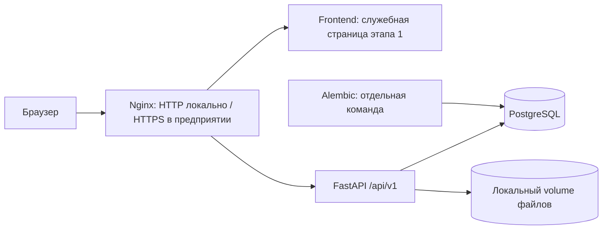

# Архитектура — этап 1

## Назначение и границы

ИТ-элемент [29] — внутренняя многопользовательская система учёта IT-оборудования,
расходных материалов, выдач, перемещений и обслуживания. Стек задан исходным ТЗ.
В этом изменении реализуется только серверная основа. Источники CartridgeDesk
не предоставлены и в исходно пустой рабочей папке отсутствуют; правила не выдумываются.

Этап 1 готов по коду, когда доступны конфигурация, FastAPI, PostgreSQL-миграция,
health checks, тесты, Compose и инструкции. Приёмка контейнерного запуска отдельно
требует Docker Engine. Нельзя считать этапы 2–8 выполненными по наличию таблиц или схем.

## Выбор архитектуры

Выбран модульный монолит: один API, одна PostgreSQL, локальное файловое хранилище.
Он позволяет проводить выдачу и перемещение одной транзакцией и проще обслуживается
в локальной сети. Микросервисы требуют распределённых транзакций без пользы для v0.1.
Единый файл со всеми route и SQL быстрее создать, но он затрудняет права и тестирование.



## Репозиторий и зависимости

```text
backend/
  app/main.py            фабрика приложения и lifecycle
  app/core/config.py     проверяемая конфигурация из окружения
  app/db/                engine, Session, metadata
  app/modules/health/    liveness и readiness
  app/modules/directory/ ORM справочников (без CRUD API)
  migrations/            Alembic, начальная схема
  tests/                 unit и PostgreSQL integration
frontend/                только служебная HTML-страница и Dockerfile
infra/nginx/             локальный proxy и шаблон корпоративного TLS
docs/                    развёртывание, план, проверка
assets/brand/            оригинальные вложения пользователя
```

Будущие модули: identity, inventory, equipment, movements, maintenance, audit, reports.
Каждый содержит router, schemas, service и repository по мере появления реального кода;
пустые имитации этих модулей не создаются. Router проверяет входные данные и permissions,
service задаёт границы транзакции и бизнес-инварианты, repository работает с БД.
Frontend этапа 2: React, TypeScript, Vite, Tailwind, shadcn/ui, TanStack Query/Table,
React Hook Form, Zod, Lucide, Recharts. Сейчас не устанавливается неиспользуемый стек UI.

## Серверный контракт этапа 1

- GET /api/v1/health/live: 200, если HTTP-процесс жив, независимо от БД.
- GET /api/v1/health/ready: 200 только при доступной БД и текущей ревизии Alembic;
  иначе 503 с общим сообщением без DSN и SQL. Проверка имеет ограничение времени.
- Документация OpenAPI по умолчанию выключена; включается явно только для разработки.
- Нет открытых CRUD, административных методов, загрузки файлов, пользователей или
  фиктивной авторизации. Неизвестные API пути возвращают 404.
- Сессия БД создаётся на запрос и закрывается с rollback незавершённой транзакции;
  commit делает только service явно. Engine освобождается при остановке приложения.

## Данные и надёжность

Физически на этапе 1: departments, employees, locations и alembic_version.
Полная целевая модель описана в DATABASE.md; остальные таблицы добавляются миграциями
владельцев модулей, когда реализуются соответствующие правила.
FK RESTRICT защищают от удаления связанных объектов. UUID, created_at/updated_at,
archived_at, timestamptz. Миграции не зависят от импортируемых текущих ORM моделей.

Выдача: блокировать inventory_items в стабильном порядке UUID, рассчитать сумму движений,
проверить остаток, записать документ и движения в одной транзакции. Повтор POST в будущем
защищается ключом идемпотентности. Исправления — компенсирующие операции с аудитом.
Перемещение: блокировать оборудование; одним commit менять текущее состояние и писать историю.
Исторический Excel импорт не перезаписывает подтверждённое текущее положение автоматически.

## Безопасность и эксплуатация

По умолчанию Compose слушает только 127.0.0.1:8080. PostgreSQL и backend не публикуют порты.
Секреты обязательны через .env, который игнорируется Git; стандартного пароля нет.
Nginx ограничивает размер запроса. CORS не включён: браузер и API используют один origin.
На этапе 2: серверные сессии (HttpOnly, Secure, SameSite), CSRF, Argon2id, RBAC,
ограничение попыток входа и CLI создания первого администратора без стандартного пароля.
До этого этапа нельзя загружать реальные данные и считать каркас производственной системой.

Для предприятия TLS завершается на согласованном proxy с сертификатом корпоративной PKI.
Бэкап включает PostgreSQL и files volume; процедура и обязательный restore drill описаны
в docs/DEPLOYMENT.md. Логи не должны содержать строки подключения и содержимое запросов.

## Проверка

Unit: обязательные настройки, корректное кодирование пароля в DSN, отказ readiness,
выключенная документация, отсутствие бизнес-endpoint. Integration на реальной PostgreSQL:
upgrade → CRUD через ORM → FK/unique/check → rollback → drift check → downgrade → upgrade.
Контейнерная проверка: build, config, up, health, рестарт с сохранением данных.
В PROGRESS.md записывается только фактически проверенное.

## Основания

- [FastAPI: контейнеры и lifecycle](https://fastapi.tiangolo.com/deployment/docker/)
- [SQLAlchemy: PostgreSQL и psycopg](https://docs.sqlalchemy.org/en/20/dialects/postgresql.html)
- [Alembic: управление миграциями](https://alembic.sqlalchemy.org/en/latest/tutorial.html)
