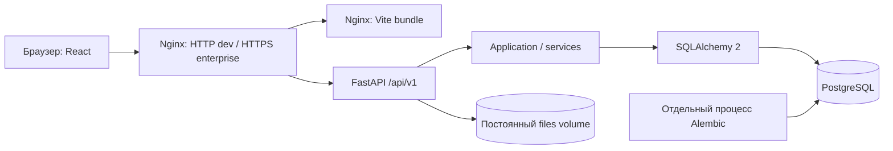

# Архитектура — этапы 1–2

## Назначение и границы

ИТ-элемент [29] — внутренняя многопользовательская система учёта ИТ-ресурсов.
Сейчас реализованы инфраструктура, справочники без CRUD, авторизация/RBAC и React UI.
Склад, оборудование, движения, обслуживание и отчёты пока представлены маршрутами
«В разработке». Наличие меню не означает реализации бизнес-операций.

## Модульный монолит

Один API и одна БД позволяют будущим выдачам и перемещениям выполняться атомарно.
Router проверяет запрос и серверные permissions; service управляет транзакцией и
инвариантами; repository выполняет запросы. Используются параметризованные SQLAlchemy
запросы. Создание/отзыв сессии, изменение пользователя и аудит фиксируются одним commit.
Закрытие request Session откатывает незавершённую транзакцию. Engine закрывается в lifespan.

## Структура

- `backend/app/modules/health`: liveness и readiness с проверкой точного Alembic head.
- `backend/app/modules/directory`: модели departments/employees/locations, без CRUD API.
- `backend/app/modules/identity`: схемы, права, сессии, CSRF, сервисы и административные API.
- `backend/app/modules/dashboard`: восемь недоступных метрик (null), реальные события текущего пользователя.
- `backend/app/cli.py`: интерактивный bootstrap администратора и provisioning runtime-роли.
- `backend/migrations`: неизменённая 0001_directories и новая 0002_identity.
- `frontend/src`: React/TypeScript, Router, TanStack Query, Tailwind, shadcn/Radix, Lucide.
- `frontend/src/components`: общие layout, формы, таблица, состояния и диалоги.
- `frontend/e2e`: браузерная приёмка через настоящий API.
- `deploy`, `scripts/release`, `scripts/deploy`: отдельный выпуск и серверное развёртывание.
- `assets/brand`: исходные PNG; копии frontend совпадают побайтно.

## Сессии и разрешения

Случайный bearer-токен передаётся только HttpOnly cookie с SameSite=Lax. В PostgreSQL
хранится SHA-256 токена; браузерный storage не используется. CSRF-токен хранится в памяти
React и восстанавливается через API. Каждый изменяющий запрос проверяет точный Origin,
CSRF и живую сессию; вход тоже защищён предварительной короткой сессией.
Production требует Secure cookie и HTTPS origin. CORS не открыт: UI/API имеют общий origin.
Пароли хешируются Argon2id; открытых паролей нет в БД, аудите или логах.

Четыре роли имеют одну текущую роль на пользователя; permissions читаются из БД.
Manager просматривает, Storekeeper имеет складские права, IT Specialist — выдачу,
оборудование/перемещения/обслуживание, Administrator — все разрешения. Скрытие меню
дополняет серверную проверку; прямой административный HTTP без прав получает 403.
Точный список — в docs/STAGE-2-DESIGN.md.

Временный пароль требует смены до доступа к рабочим API. Смена/сброс пароля, блокировка
и изменение роли отзывают сессии. Административные изменения используют transaction-level
advisory lock; после ожидания повторно проверяются роль, активность и живая исходная сессия.
Нельзя понизить собственную роль, заблокировать себя или убрать последнего администратора.
Лимиты входа атомарны и хранятся в PostgreSQL, поэтому общие для всех API workers.

## Граница доверия reverse proxy

В контейнерах backend принимает forwarded headers только в приватном контуре Compose:
порт API не публикуется, Nginx всегда заменяет X-Forwarded-For адресом соединения.
Это позволяет ограничивать вход по адресу клиента, а не общему адресу proxy.
Не подключайте недоверенные контейнеры к этой сети и не публикуйте API отдельно.
В нативном запуске proxy headers выключены. При добавлении корпоративного балансировщика
нужно отдельно настроить доверенные адреса на Nginx; входящему произвольному XFF доверять нельзя.

Access logs URL отключены в Uvicorn/Nginx: строка поиска может содержать персональные
данные. PostgreSQL не выводит параметры, текст SQL и DETAIL ошибочных строк.
Остаются диагностика запуска/остановки, health и отдельный прикладной аудит в БД.
В audit_logs runtime-роли разрешены SELECT/INSERT, но не UPDATE/DELETE.

## Данные и развёртывание

PostgreSQL — единственная основная БД. UUID, UTC timestamptz, архивирование и FK RESTRICT
сохраняют историю. Миграции явные и не вызываются API. Владелец схемы и runtime-роль
разделены; runtime не может менять DDL, удалять пользователей или править аудит.

Dev Compose — локальный HTTP. Staging/production — отдельный deploy/compose.yaml,
раздельные внешние volumes, secrets, DNS и TLS. Выпуск содержит готовые Linux images,
manifest и контрольные суммы; сервер не собирает код и не скачивает images.
Обновление выполняет проверенный backup до миграций. Восстановление требует отдельной
команды и явного подтверждения; downgrade БД автоматически не выполняется.

Будущие инварианты: остаток только SUM(inventory_movements.delta) с FOR UPDATE на позиции;
текущее положение equipment хранится в equipment; документ, строки, движение и аудит —
одна транзакция. Эти правила описывают этапы 3+, а не существующие таблицы.
