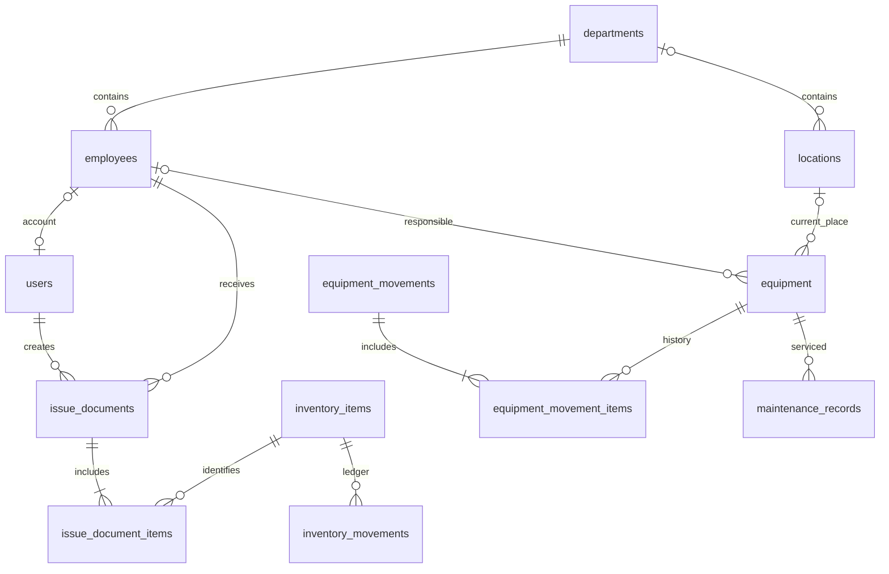

# Модель данных

## Общие правила

UUID первичные ключи; UTC timestamptz для событий, date для дат документов, если время
не является бизнес-данными. Вывод дат — в часовом поясе пользователя (по умолчанию
Asia/Yekaterinburg). Связи по ID, не по серийным номерам или ФИО. История не удаляется
каскадом. Архивные справочники остаются доступны историческим документам.

## Физическая схема этапа 1

| Таблица | Поля помимо UUID и временных меток | Ограничения |
|---|---|---|
| departments | code varchar(50), name varchar(200), archived_at | уникальный непустой code, непустой name |
| employees | personnel_number varchar(50), full_name varchar(300), department_id, archived_at | уникальный непустой табельный номер, FK departments RESTRICT, индекс FK |
| locations | code varchar(50), name varchar(200), department_id nullable, archived_at | уникальный code, FK departments RESTRICT, индекс FK |

created_at и updated_at имеют серверный DEFAULT now(); updated_at обновляется ORM при
UPDATE. Прямой SQL-писатель обязан обновить updated_at явно. UUID создаёт приложение.
Все даты timezone-aware. Имена FK/UK/CK/индексов детерминированы.

## Целевая схема последующих этапов — ещё НЕ мигрирована

| Этап | Сущности | Назначение и ключевые связи |
|---|---|---|
| 2 | users, roles, permissions, user_roles, role_permissions, sessions | users.employee_id nullable UNIQUE; логин нормализован UNIQUE; password_hash; sessions хранит хеш токена, expiry, revoke; связи M:N |
| 3 | manufacturers, inventory_categories, printer_models, inventory_items, inventory_compatibilities | модель не глобально уникальна; производитель расходника отдельно от производителя принтера; M:N совместимость |
| 3 | issue_documents, issue_document_items, inventory_movements | получатель FK employees, автор FK users; qty строк >0; signed delta движений !=0; ссылки на документ и строку; тип receipt/issue/return/adjustment/reversal |
| 4 | equipment_categories, equipment, equipment_links | serial_number nullable и индексируется, inventory_number UNIQUE nullable; category_id, location_id, responsible_employee_id, department_id, status, attributes JSONB |
| 5 | equipment_movements, equipment_movement_items | документ и несколько equipment_id; снимки from/to location, employee, department; UUID устройств, причина, автор, occurred_at; отмена отдельным документом |
| 6 | maintenance_records, maintenance_revisions | equipment_id, work_type, status, scheduled/completed_at, description, work_done, executor_id; версии содержат изменённые поля |
| 3+ | file_attachments и типизированные таблицы связей | storage_key UUID, media_type, size, hash, uploader; FK к владельцу через inventory_item_attachments/equipment_attachments, а не незащищённый polymorphic FK |
| 2+ | audit_logs | actor_id nullable, timestamp, action, entity_type, entity_id, before/after JSONB без секретов; append-only для runtime роли |
| позже | import_batches, import_rows | staging, mapping, errors, confirmation, source hash; импорт GLPI.xlsx только после предпросмотра и подтверждения |

## Источники истины и транзакции

**Склад:** только SUM(inventory_movements.delta) определяет остаток. Поле balance в
inventory_items не создаётся. При записи lock строки позиции → sum → проверка >=0 →
запись движения. Все писатели обязаны использовать этот protocol; runtime не предоставляет
прямого редактирования движения. Массовая выдача атомарна, блокировки в порядке UUID.
Отмена добавляет обратные движения, повторная отмена запрещена unique-связью reversal_of.

**Оборудование:** current location/responsible/department/status в equipment — текущая
подтверждённая версия. Движения — неизменяемая история с before/after, а не второй источник
текущего состояния. Обновление и история в одной транзакции с row lock и проверкой версии.
Списанное устройство не перемещается обычной операцией. Для неподтверждённого импорта
отдельный location_verification_status; неизвестное значение не маскируется складом.

**Аудит:** отличается от журнала бизнес-операций; записывается в той же транзакции.
Секреты исключаются по allowlist полей. Runtime роль не получает UPDATE/DELETE audit_logs.
Роль мигратора и runtime будут разделены при внедрении авторизации этапа 2; текущий
Compose использует bootstrap owner только для пустого технического окружения.

Индексы следующих этапов: inventory_movements(item_id, occurred_at), equipment(serial_number),
equipment(location_id, status), movement_items(equipment_id), maintenance(equipment_id, date),
audit_logs(entity_type, entity_id, timestamp), expiry sessions. Точные check/unique и индексы
включаются в миграцию вместе с тестами правил соответствующего этапа.
