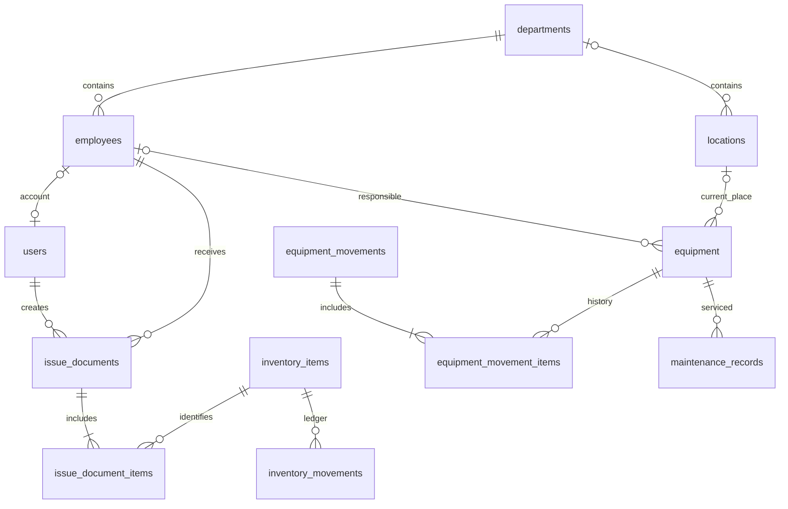

# Модель данных

## Общие правила

UUID первичные ключи; UTC timestamptz для событий, date для дат документов, если время
не является бизнес-данными. Вывод дат — в часовом поясе пользователя (по умолчанию
Asia/Yekaterinburg). Связи по ID, не по серийным номерам или ФИО. История не удаляется
каскадом. Архивные справочники остаются доступны историческим документам.

## Физическая схема этапа 1

| Таблица | Поля помимо UUID и временных меток | Ограничения |
|---|---|---|
| departments | code varchar(50), name varchar(200), archived_at | уникальный непустой code, непустой name |
| employees | personnel_number varchar(50), full_name varchar(300), department_id, archived_at | уникальный непустой табельный номер, FK departments RESTRICT, индекс FK |
| locations | code varchar(50), name varchar(200), department_id nullable, archived_at | уникальный code, FK departments RESTRICT, индекс FK |

created_at и updated_at имеют серверный DEFAULT now(); updated_at обновляется ORM при
UPDATE. Прямой SQL-писатель обязан обновить updated_at явно. UUID создаёт приложение.
Все даты timezone-aware. Имена FK/UK/CK/индексов детерминированы.

## Физическая схема этапа 2

Миграция `0002_identity` добавляет следующие таблицы; `0001_directories` не изменялась.

| Таблица | Ключ и поля | Ограничения |
|---|---|---|
| users | UUID, username, display_name, password_hash, role_code, is_active, must_change_password, created_at/updated_at/archived_at | нормализованный уникальный логин, непустое имя, FK roles RESTRICT |
| roles | code PK, name | четыре роли, фиксированные seed-данные миграции |
| permissions | code PK | серверные разрешения |
| role_permissions | role_code + permission_code PK | FK RESTRICT |
| sessions | token_hash PK, user_id nullable, created_at, expires_at | SHA-256 токена, FK users RESTRICT; индексы user_id/expiry |
| auth_rate_limits | key_hash PK, attempts, window_start | attempts > 0, атомарный PostgreSQL upsert |
| audit_logs | UUID, actor_id nullable, action, target_id nullable, changes JSONB, occurred_at | FK actor RESTRICT; runtime только SELECT/INSERT |

У пользователя одна роль через `users.role_code`; M:N user_roles и связь с employees
не добавлялись без нужды текущего этапа. Коды roles/permissions и хеши технических
сессий/лимитов — естественные ключи; бизнес-сущности используют UUID.
Отзыв сессии удаляет её техническую запись, сохраняя аудит и пользователя.
Все временные поля — timestamptz UTC. Аудит содержит только разрешённые поля изменений,
никогда пароль, хеш пароля, bearer/CSRF-токен или тело запроса целиком.

## Физическая схема этапа 3

`0003_inventory` добавляет каталог, склад и фотографии; `0004_inventory_drafts` —
личные черновики. Выпущенные ревизии не редактируются.

| Таблицы | Назначение и инварианты |
|---|---|
| manufacturers, inventory_categories, printer_models | справочники, нормализация ключей, архивирование, optimistic version |
| inventory_items, inventory_compatibilities | код, артикул, модель, категория, производитель, min_stock; M:N совместимость |
| inventory_documents, inventory_document_items | receipt/issue/reversal, автор, дата, снимки получателя/подразделения/номенклатуры, idempotency key + hash; положительные количества |
| inventory_movements | signed delta, ссылка на документ и строку; единственный источник остатка, runtime без UPDATE/DELETE |
| inventory_drafts | автор, тип, частичный payload JSONB, version, статус и ссылка на проведённый документ |
| file_attachments, inventory_item_attachments | безопасный storage_key, media_type, размер, SHA256, загрузивший; основное фото и архивные связи |

Новая forward-миграция `0005_inventory_document_details` добавляет nullable снимки поставщика
`supplier_name` и кабинета получателя `recipient_room`; старые документы не требуют
выдуманных значений. До обновления действующего стенда обязательна проверенная копия
БД и файлов. Тесты применяют миграции только к новым изолированным БД.

## Целевая схема последующих этапов — ещё НЕ мигрирована

| Этап | Сущности | Назначение и ключевые связи |
|---|---|---|
| 4 | equipment_categories, equipment, equipment_links | serial_number nullable и индексируется, inventory_number UNIQUE nullable; category_id, location_id, responsible_employee_id, department_id, status, attributes JSONB |
| 5 | equipment_movements, equipment_movement_items | документ и несколько equipment_id; снимки from/to location, employee, department; UUID устройств, причина, автор, occurred_at; отмена отдельным документом |
| 6 | maintenance_records, maintenance_revisions | equipment_id, work_type, status, scheduled/completed_at, description, work_done, executor_id; версии содержат изменённые поля |
| 4+ | equipment_attachments | типизированные FK связи с существующим файловым хранилищем |
| 4+ | расширение audit_logs | аудит оборудования добавляется вместе с реальными бизнес-операциями |
| позже | import_batches, import_rows | staging, mapping, errors, confirmation, source hash; импорт GLPI.xlsx только после предпросмотра и подтверждения |

## Источники истины и транзакции

**Склад:** только SUM(inventory_movements.delta) определяет остаток. Поле balance в
inventory_items не создаётся. При записи lock строки позиции → sum → проверка >=0 →
запись движения. Все писатели обязаны использовать этот protocol; runtime не предоставляет
прямого редактирования движения. Массовая выдача атомарна, блокировки в порядке UUID.
Отмена добавляет обратные движения, повторная отмена запрещена unique-связью reversal_of.

**Оборудование:** current location/responsible/department/status в equipment — текущая
подтверждённая версия. Движения — неизменяемая история с before/after, а не второй источник
текущего состояния. Обновление и история в одной транзакции с row lock и проверкой версии.
Списанное устройство не перемещается обычной операцией. Для неподтверждённого импорта
отдельный location_verification_status; неизвестное значение не маскируется складом.

**Аудит:** отличается от журнала бизнес-операций; записывается в той же транзакции.
Секреты исключаются по allowlist полей. Runtime роль не получает UPDATE/DELETE audit_logs.
Роль мигратора и runtime разделяет `app.cli provision-db-role`. После новой миграции
deploy повторяет выдачу разрешений. Старый dev .env без APP_DB_* сохраняет owner fallback;
production такого fallback не допускает. Runtime не получает CREATE и удаление users.

Индексы следующих этапов: inventory_movements(item_id, occurred_at), equipment(serial_number),
equipment(location_id, status), movement_items(equipment_id), maintenance(equipment_id, date),
audit_logs(entity_type, entity_id, timestamp), expiry sessions. Точные check/unique и индексы
включаются в миграцию вместе с тестами правил соответствующего этапа.
